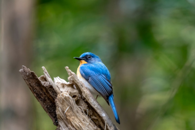
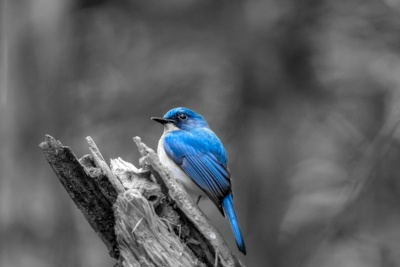
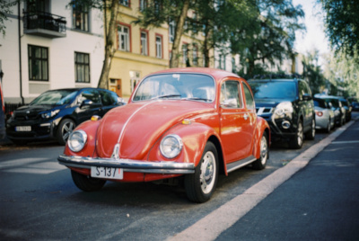
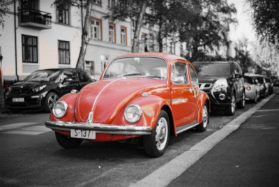

# Descoloração seletiva em C

Ferramenta de linha de comando desenvolvida em linguagem C para **descoloração seletiva de imagens** (*color splash* / *selective desaturation*) com base no espaço de cores **HSL** (*Hue*, *Saturation*, *Lightness*).

O programa analisa cada pixel da imagem de entrada e preserva as cores originais apenas dos pixels cujas componentes de **Matiz (H)**, **Saturação (S)** e **Luminosidade (L)** estejam dentro dos intervalos definidos pelo usuário. Todos os demais pixels fora do intervalo selecionado são convertidos para tons de cinza de acordo com a equação de luminância relativa padrão (ITU-R BT.709).

---

## Sumário

- [Funcionamento e Modelo Matemático](#funcionamento-e-modelo-matemático)
  - [Conversão RGB para HSL](#conversão-rgb-para-hsl)
  - [Seleção de Intervalos e Circularidade da Matiz](#seleção-de-intervalos-e-circularidade-da-matiz)
  - [Conversão para Escala de Cinza (Luminância)](#conversão-para-escala-de-cinza-luminância)
- [Formatos Suportados](#formatos-suportados)
- [Requisitos e Compilação](#requisitos-e-compilação)
- [Sintaxe e Parâmetros](#sintaxe-e-parâmetros)
- [Exemplos de Uso](#exemplos-de-uso)
- [Licença](#licença)
- [Referências Bibliográficas](#referências-bibliográficas)

---

## Funcionamento e Modelo Matemático

### Conversão RGB para HSL

Para cada pixel da imagem, as componentes $`R, G, B \in [0, 255]`$ são normalizadas para o intervalo $`[0, 1]`$:

$`r = \frac{R}{255}, \quad g = \frac{G}{255}, \quad b = \frac{B}{255}`$

Sejam $`M = \max(r, g, b)`$, $`m = \min(r, g, b)$ e $C = M - m`$:

1. **Luminosidade (L)**:
   $`L = \frac{M + m}{2} \times 100 \quad \in [0, 100]`$

2. **Saturação (S)**:
   $`S = \begin{cases} 0, & \text{se } C = 0 \\ \frac{C}{M + m} \times 100, & \text{se } L < 50\% \\ \frac{C}{2 - M - m} \times 100, & \text{se } L \ge 50\% \end{cases} \quad \in [0, 100]`$

3. **Matiz (H)**:
   $`H = \begin{cases} 0^\circ, & \text{se } C = 0 \\ 60^\circ \times \left(\frac{g - b}{C}\right) \bmod 360^\circ, & \text{se } M = r \\ 60^\circ \times \left(\frac{b - r}{C} + 2\right), & \text{se } M = g \\ 60^\circ \times \left(\frac{r - g}{C} + 4\right), & \text{se } M = b \end{cases} \quad \in [0, 360]`$

### Seleção de Intervalos e Circularidade da Matiz

O círculo cromático da matiz ($`H`$) é contínuo e periódico ($`0^\circ \equiv 360^\circ`$, correspondendo ao vermelho puro). Por isso, o programa suporta dois modos de intervalo `[inicio, fim]`:

- **Intervalo direto (`inicio <= fim`)**: seleciona valores $`x`$ tais que $`\text{inicio} \le x \le \text{fim}`$.
  - Exemplo: `-h 200 260` mantém tons de azul.
- **Intervalo circular/invertido (`inicio > fim`)**: seleciona valores que atravessam o limite $`360^\circ \to 0^\circ`$, isto é, $`x \ge \text{inicio}`$ **ou** $`x \le \text{fim}`$.
  - Exemplo: `-h 330 30` mantém tons de magenta, vermelho e laranja-avermelhado.

Caso apenas um número seja informado após `-h`, `-s` ou `-l`, o programa adota esse valor tanto para o limite inicial quanto para o limite final do respectivo canal.

### Conversão para Escala de Cinza (Luminância)

Os pixels que ficam fora dos intervalos especificados de Matiz, Saturação ou Luminosidade têm suas componentes $`R, G, B`$ substituídas pelo valor de luminância relativa $`Y`$ (recomendação **ITU-R BT.709** / espaço **sRGB**), que reflete a sensibilidade fotópica do olho humano (maior ao verde, intermediária ao vermelho e menor ao azul):

$`Y = \text{round}(0{,}2126 \cdot R + 0{,}7152 \cdot G + 0{,}0722 \cdot B)`$

$`R' = G' = B' = Y`$

Canais de transparência (*alpha*), quando presentes na imagem original, são integralmente preservados.

---

## Formatos Suportados

O programa identifica automaticamente o formato do arquivo de entrada através da assinatura binária (*magic bytes*) no cabeçalho do arquivo (ou pela extensão, como *fallback*) e determina o formato de saída pela extensão informada em `-o` / `--out`.

É possível **manter o mesmo formato** ou **converter entre formatos diferentes** na mesma execução (por exemplo, ler um arquivo `.png` e gravar a saída descolorida em `.jpg` ou `.webp`):

| Formato | Extensões | Biblioteca / Implementação | Recursos Suportados |
| :--- | :--- | :--- | :--- |
| **PNG** | `.png` | `libpng` | RGB, RGBA, paleta, escala de cinza, 8/16 bits, nível de compressão (`-z 0..9`) |
| **TIFF** | `.tif`, `.tiff` | `libtiff` | RGB e RGBA, compressão configurável (`none`, `lzw`, `deflate`/`zip`, `packbits`) |
| **JPEG** | `.jpg`, `.jpeg` | `libjpeg` | RGB, controle da qualidade de compressão (`-q 1..100`) |
| **GIF** | `.gif` | `giflib` | Edição direta de paleta (GIF $`\to`$ GIF preservando animação/transparência) e quantização de cores |
| **WebP** | `.webp` | `libwebp` | RGB e RGBA, modo com perdas (`-q 1..100`) e modo sem perdas (`--lossless`) |
| **BMP** | `.bmp` | C puro (nativo) | 24 bits (BGR) e 32 bits (BGRA), orientação *bottom-up* e *top-down* |
| **Netpbm** | `.ppm`, `.pgm`, `.pnm` | C puro (nativo) | Leitura de `P2`, `P3`, `P5` e `P6`; escrita binária (`P6`/`P5`) ou ASCII (`--ascii`, `P3`/`P2`) |

---

## Requisitos e Compilação

### Dependências

Para compilar o projeto em distribuições Linux, instale os pacotes de desenvolvimento das bibliotecas de imagem:

- **Fedora / RHEL / Rocky Linux:**
  ```bash
  sudo dnf install gcc make libpng-devel libtiff-devel libjpeg-turbo-devel giflib-devel libwebp-devel
  ```
- **Debian / Ubuntu / Linux Mint:**
  ```bash
  sudo apt install build-essential libpng-dev libtiff-dev libjpeg-dev libgif-dev libwebp-dev
  ```
- **Arch Linux:**
  ```bash
  sudo pacman -S base-devel libpng libtiff libjpeg-turbo giflib libwebp
  ```

### Compilando o programa

Utilizando o `Makefile` incluído na pasta `src`:

```bash
make -C src
```

Ou compilando diretamente com o `gcc`:

```bash
gcc -Wall -Wextra -O2 src/descolorir.c -o src/descolorir -lpng -ltiff -ljpeg -lgif -lwebp -lm
```

---

## Sintaxe e Parâmetros

```text
Uso:
  ./descolorir <arquivo_entrada> -o <arquivo_saida> (-h <inicio> [<fim>] | -s <inicio> [<fim>] | -l <inicio> [<fim>]) [opções]
```

Os parâmetros podem ser informados em **qualquer ordem** na linha de comando, respeitando apenas a sequência `<inicio> [<fim>]` logo após cada opção de intervalo.

| Parâmetro | Versão Longa | Argumentos | Padrão | Descrição |
| :--- | :--- | :--- | :---: | :--- |
| `<arquivo_entrada>` | — | caminho | *(obrigatório)* | Imagem original de entrada |
| `-o` | `--out` | `<arquivo_saida>` | *(obrigatório)* | Caminho da imagem de saída |
| `-h` | `--hue` | `<inicio> [<fim>]` | `0 360` | Intervalo de Matiz (*Hue*) de `0` a `360` |
| `-s` | `--saturation` | `<inicio> [<fim>]` | `100 100` | Intervalo de Saturação (*Saturation*) de `0` a `100` |
| `-l` | `--lightness` | `<inicio> [<fim>]` | `50 50` | Intervalo de Luminosidade (*Lightness*) de `0` a `100` |
| `-q` | `--quality` | `<qualidade>` | `95` | Qualidade de saída para JPEG e WebP (`1` a `100`) |
| `-z` | `--png-level` | `<nivel>` | `6` | Nível de compressão do PNG (`0` = sem compressão a `9` = máxima) |
| `-c` | `--compression` | `<tipo>` | `none` | Compressão do TIFF: `none`, `lzw`, `deflate`, `zip`, `packbits` |
| — | `--lossless` | — | desativado | Grava arquivos WebP em modo sem perdas (*lossless*) |
| — | `--ascii` | — | desativado | Grava arquivos PPM/PGM em modo texto ASCII (`P3`/`P2`) |
| — | `--help` | — | — | Exibe a ajuda completa e o diagrama colorido do espaço HSL no terminal |

> **Nota:** É obrigatório informar o arquivo de entrada, o arquivo de saída (`-o`/`--out`) e **pelo menos um** dos intervalos HSL (`-h`, `-s` ou `-l`). Ao executar `./src/descolorir --help`, o programa exibe no terminal um diagrama colorido em ANSI *TrueColor* ilustrando as escalas de `H` (`0..360` com `L` de `10` a `90`), `S` (`0..100`) e `L` (`0..100`).

---

## Exemplos de Uso

### 1. Destacando apenas tons de azul em uma imagem PNG

Mantém coloridos os pixels com matiz entre `200°` e `260°`, saturação entre `15%` e `100%` e luminosidade entre `10%` e `90%`:

```bash
./descolorir pexels-quang-c.jpg -o pexels-quang-d.jpg -h 200 260 -s 15 100 -l 10 90
```

| Imagem Original | Saída Descolorida (Azul: H 200..260) |
| :---: | :---: |
|  |  |

&copy; Photo by Quang Nguyen Vinh: [https://www.pexels.com/photo/colorful-blue-and-orange-bird-perched-on-wood-30750701/](https://www.pexels.com/photo/colorful-blue-and-orange-bird-perched-on-wood-30750701/)

### 2. Destacando tons de vermelho com intervalo circular (`inicio > fim`)

Como o vermelho encontra-se na transição entre `360°` e `0°` do círculo cromático, basta informar o início maior que o fim (por exemplo, de `335°` a `25°`):

```bash
./descolorir pexels-borisk-c.jpg -o pexels-borisk-d.jpg -h 335 25 -s 20 100 -l 10 90 -q 92
```

| Imagem Original | Saída Descolorida (Vermelho: H 335..25) |
| :---: | :---: |
|  |  |

&copy; Photo by Boris K.: [https://www.pexels.com/photo/classic-red-volkswagen-beetle-on-city-street-33492072/](https://www.pexels.com/photo/classic-red-volkswagen-beetle-on-city-street-33492072/)

### 3. Usando valor único para início e fim

Quando apenas um número é informado para `-h`, `-s` ou `-l`, ele é usado como início e fim do intervalo:

```bash
./descolorir entrada.png -o saida_matiz_120.png -h 120 -s 50 100 -l 20 80
```

### 4. Convertendo formatos e ajustando parâmetros específicos

```bash
# Ler um arquivo TIFF e salvar como WebP sem perdas (lossless):
./descolorir entrada.tif -o saida.webp --hue 80 150 --saturation 20 100 --lightness 15 85 --lossless

# Ler um arquivo PNG e salvar como TIFF comprimido com LZW:
./descolorir entrada.png -o saida.tif -h 40 70 -s 30 100 -l 20 90 -c lzw

# Ler um arquivo JPEG e salvar como PPM em formato texto ASCII (P3):
./descolorir entrada.jpg -o saida.ppm -h 200 260 -s 10 100 -l 10 90 --ascii
```

---

## Licença

Este projeto é distribuído sob a licença **GNU General Public License v3.0 (GPLv3)**. Consulte o texto oficial da licença em [https://www.gnu.org/licenses/gpl-3.0.html](https://www.gnu.org/licenses/gpl-3.0.html) para mais detalhes.

---

## Referências Bibliográficas

1. **GONZALEZ, Rafael C.; WOODS, Richard E.** *Processamento Digital de Imagens*. 3. ed. São Paulo: Pearson Prentice Hall, 2010. (Capítulo 6: Processamento de Imagens Coloridas).
2. **FOLEY, James D.; VAN DAM, Andries; FEINER, Steven K.; HUGHES, John F.** *Computer Graphics: Principles and Practice*. 3. ed. Upper Saddle River: Addison-Wesley, 2013. (Algoritmos de conversão entre os espaços de cores RGB, HSV e HSL).
3. **SMITH, Alvy Ray.** Color Gamut Transform Pairs. *ACM SIGGRAPH Computer Graphics*, v. 12, n. 3, p. 12–19, ago. 1978. DOI: [10.1145/965139.807361](https://doi.org/10.1145/965139.807361).
4. **INTERNATIONAL TELECOMMUNICATION UNION (ITU).** *Recommendation ITU-R BT.709-6: Parameter values for the HDTV standards for production and international programme exchange*. Genebra: ITU, jun. 2015. (Derivação dos coeficientes de luminância relativa $Y = 0{,}2126 R + 0{,}7152 G + 0{,}0722 B$).
5. **PEDRINI, Hélio; SCHWARTZ, William Robson.** *Análise de Imagens Digitais: Princípios, Algoritmos e Aplicações*. São Paulo: Thomson Learning, 2008.
6. **ROELOFS, Greg.** *PNG: The Definitive Guide*. Sebastopol: O'Reilly Media, 1999. Documentação oficial da biblioteca `libpng`: [http://www.libpng.org/pub/png/libpng.html](http://www.libpng.org/pub/png/libpng.html).
7. **ADOBE SYSTEMS INCORPORATED.** *TIFF Revision 6.0 Specification*. Mountain View: Adobe Developers Association, jun. 1992. Documentação oficial da biblioteca `libtiff`: [https://libtiff.gitlab.io/libtiff/](https://libtiff.gitlab.io/libtiff/).
8. **WALLACE, Gregory K.** The JPEG Still Picture Compression Standard. *Communications of the ACM*, v. 34, n. 4, p. 30–44, abr. 1991. Independent JPEG Group (`libjpeg`): [https://ijg.org/](https://ijg.org/).
9. **GOOGLE INC.** *WebP Image Format & libwebp Documentation*. Disponível em: [https://developers.google.com/speed/webp](https://developers.google.com/speed/webp).
10. **RAYMOND, Eric S.; GERSHON, Elber; TOSHIO, Kuratomi.** *GIFLIB Documentation*. Disponível em: [https://giflib.sourceforge.net/](https://giflib.sourceforge.net/).
